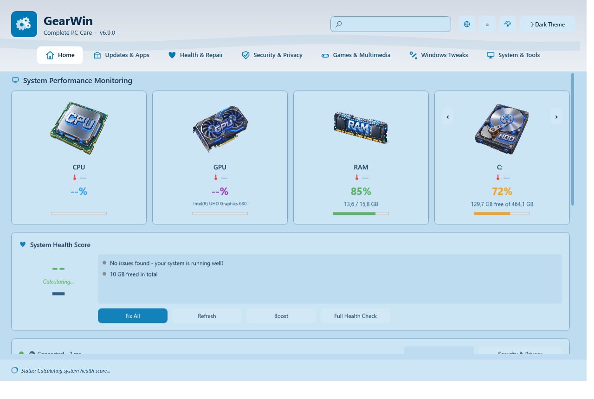
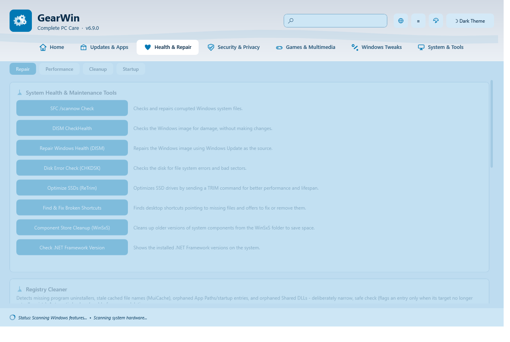
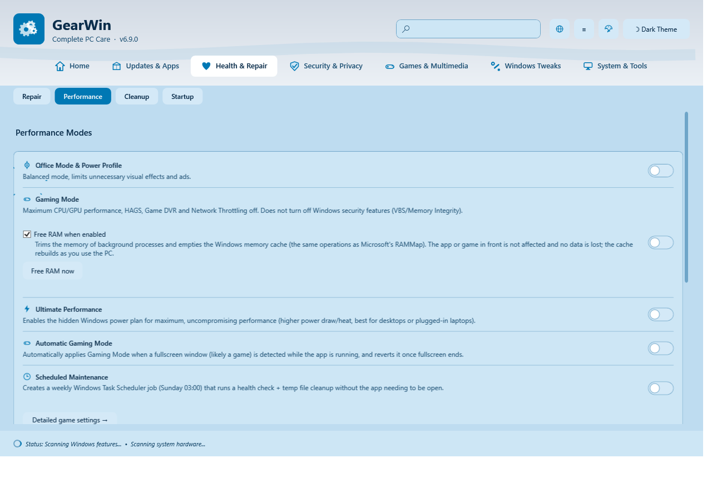
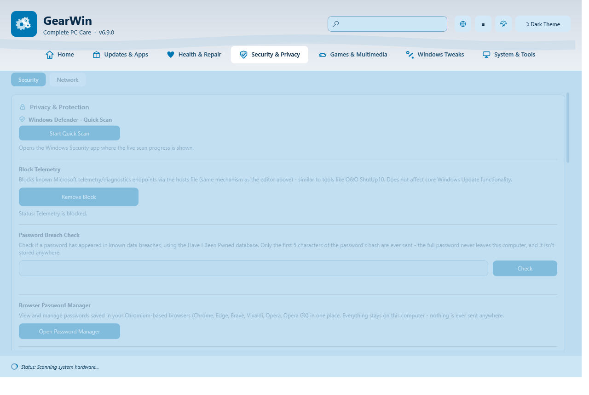
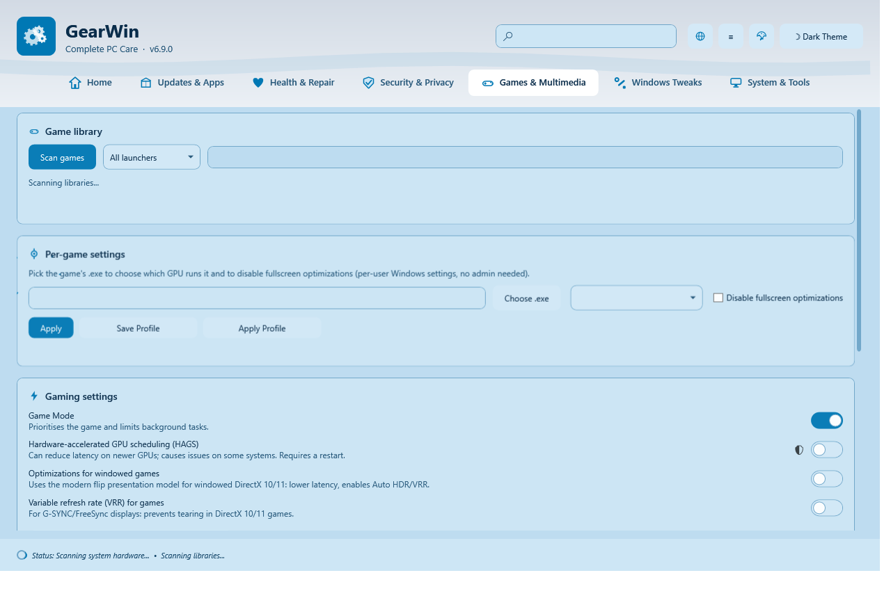
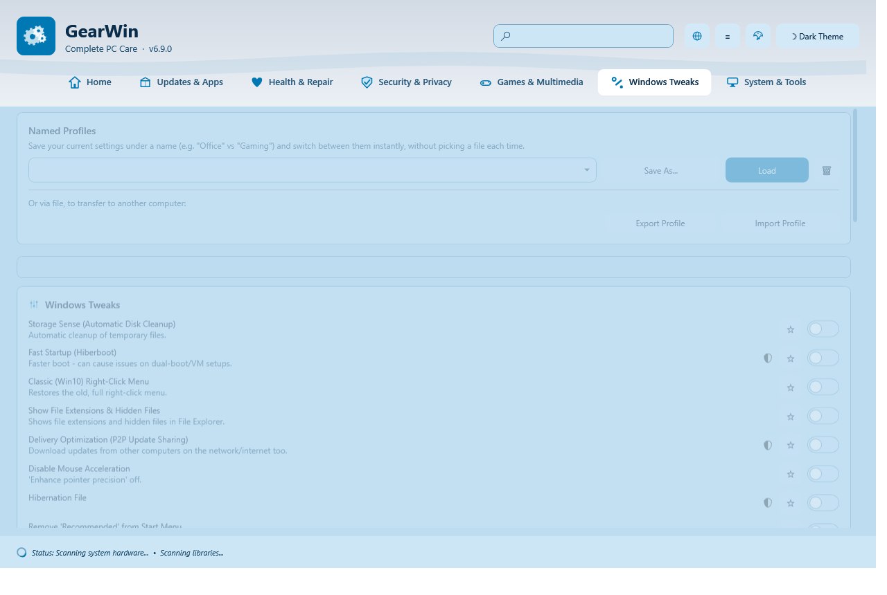
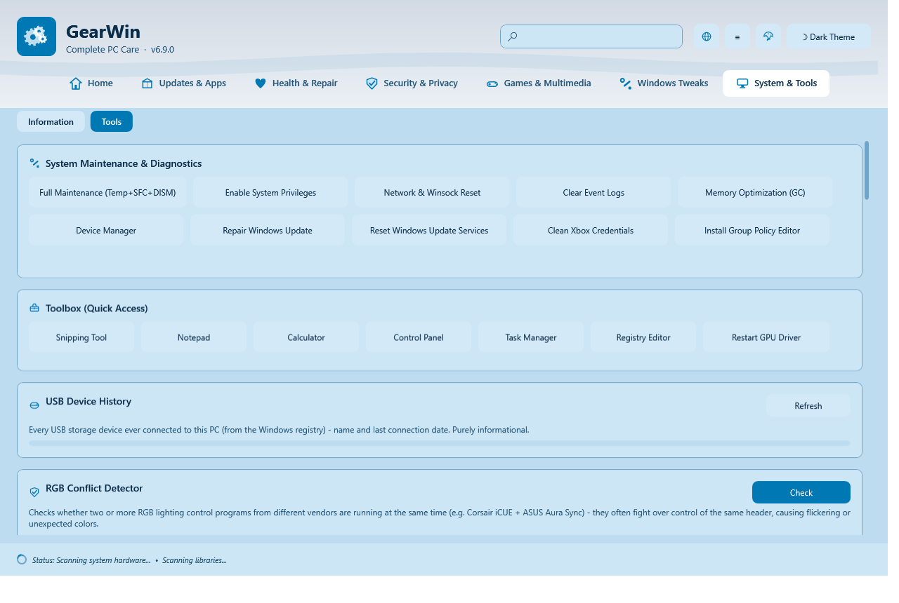

<p align="center"></p>

# GearWin — Complete PC Care

Ένα δωρεάν, ανοιχτού κώδικα εργαλείο συντήρησης και βελτιστοποίησης για Windows 11 — μαζεύει σε ένα
μέρος όλα όσα χρειάζεται ένας χρήστης για να κρατήσει τον υπολογιστή του γρήγορο, καθαρό, ασφαλή και
υπό τον δικό του έλεγχο, χωρίς να χρειάζεται δεκάδες ξεχωριστά εργαλεία ή χειροκίνητη επεξεργασία του
μητρώου των Windows.

*A free, open-source maintenance and optimization tool for Windows 11 — see the [English section](#english) below.*

## Περιεχόμενα / Contents

- [Ελληνικά](#ελληνικά)
- [English](#english)
- [Άδεια / License](#άδεια--license)

## Ελληνικά

### Λειτουργίες

Η εφαρμογή είναι οργανωμένη σε 7 καρτέλες (με υποσελίδες):

| Καρτέλα | Τι κάνει |
|---|---|
| 🏠 Αρχική | Βαθμολογία υγείας συστήματος, γρήγορες ενέργειες συντήρησης, κατάσταση σύνδεσης δικτύου με ζωντανό γράφημα ταχύτητας |
| 📦 Ενημερώσεις & Εφαρμογές | Ενημερώσεις εφαρμογών, Windows και οδηγών από πολλές πηγές (και git repos), «Σάρωση όλων», λίστα αγνόησης, ακύρωση σάρωσης, προαιρετικές νυχτερινές ενημερώσεις (προαιρετικά και Windows), απεγκατάσταση από τη λίστα, εγκατάσταση SDI core, ασφαλής αφαίρεση προεγκατεστημένων εφαρμογών και εγκατάσταση προτεινόμενων |
| ❤ Υγεία & Επισκευή | Επισκευή (SFC/DISM/CHKDSK, Καθαριστής Μητρώου, WinRE, χρονολόγιο υγείας) · Απόδοση (Office/Gaming/Ultimate, ελευθέρωση RAM) · Καθαρισμός · Εκκίνηση |
| 🛡 Ασφάλεια & Απόρρητο | Windows Defender, κανόνες Firewall και ανοιχτές θύρες, μπλοκάρισμα τηλεμετρίας, διαχειριστής κωδικών browser, DNS/hosts και εργαλεία δικτύου |
| 🎮 Παιχνίδια & Πολυμέσα | Βιβλιοθήκη Steam/Epic/GOG/Ubisoft/Xbox με εκκίνηση, προφίλ GPU/gaming ανά παιχνίδι, καθαρισμός cache launcher και αντίγραφο ασφαλείας αποθηκεύσεων |
| 🔧 Ρυθμίσεις Windows | Δεκάδες tweaks διεπαφής/απόδοσης/απορρήτου, με ασφαλή επαναφορά στην αρχική τιμή και ονομασμένα προφίλ |
| 🖥 Σύστημα & Εργαλεία | Πληροφορίες (υλικό/λειτουργικό, οθόνες, ήχος, κάμερα/μικρόφωνο, κωδικοποιητές) · Εργαλεία (αναφορές, αντίγραφα και σημεία επαναφοράς, Εργαλειοθήκη Windows, UWP εφαρμογές, WSL, ιστορικό USB, γραμματοσειρές) |

Η μετατροπή αρχείων δεν υπάρχει πια στο GearWin: γίνεται στο Opsis Media Player Pro (βίντεο/εικόνα) και στο Waveframe (ήχος) — δείτε το παράθυρο «Η οικογένεια Opsis».

Επίσης: πλήρης υποστήριξη 14 γλωσσών (Ελληνικά, Αγγλικά, Γερμανικά, Γαλλικά, Ισπανικά, Ιταλικά,
Ρωσικά, Κινέζικα, Ιαπωνικά, Πορτογαλικά, Κορεατικά, Τουρκικά, Αραβικά, Χίντι), θέματα εμφάνισης
Ανοιχτού/Σκούρου φόντου με πολλαπλά κινούμενα στυλ, οδηγός χρήσης στο πρώτο άνοιγμα, και ιστορικό
ενεργειών για πλήρη διαφάνεια στο τι άλλαξε η εφαρμογή στο σύστημα.

### Δίκτυο και απόρρητο

Το GearWin δεν στέλνει τηλεμετρία. Οι μόνες δικές του κλήσεις είναι απλά GET στο GitHub: ο ημερήσιος έλεγχος για νέα έκδοση (`api.github.com`, με ETag, ~30 δευτ. μετά την εκκίνηση και μετά ανά 24 ώρες· απενεργοποιείται από τις Ρυθμίσεις) και, όταν ανοίγετε το «Η οικογένεια Opsis», ο κατάλογος εφαρμογών (`raw.githubusercontent.com`, το πολύ μία φορά την ημέρα, επικυρωμένος, με ενσωματωμένο αντίγραφο). Οι installers άλλων εφαρμογών κατεβαίνουν μόνο μετά από επιβεβαίωσή σας, ελέγχονται με SHA-256 και δεν εκτελούνται ποτέ από το GearWin.

### Στιγμιότυπα οθόνης / Screenshots

_Η τρέχουσα διάταξη (7 καρτέλες, 6.9.x), φωτεινό θέμα / The current layout (7 tabs, 6.9.x), light theme._

<table>
<tr>
<td><br/><sub>Αρχική / Home</sub></td>
<td><br/><sub>Ενημερώσεις & Εφαρμογές / Updates & Apps (Ελληνικά / Greek UI)</sub></td>
</tr>
<tr>
<td><br/><sub>Υγεία & Επισκευή › Επισκευή / Health & Repair › Repair</sub></td>
<td><br/><sub>Υγεία & Επισκευή › Απόδοση / Health & Repair › Performance</sub></td>
</tr>
<tr>
<td><br/><sub>Ασφάλεια & Απόρρητο / Security & Privacy</sub></td>
<td><br/><sub>Παιχνίδια & Πολυμέσα / Games & Multimedia</sub></td>
</tr>
<tr>
<td><br/><sub>Ρυθμίσεις Windows / Windows Tweaks</sub></td>
<td><br/><sub>Σύστημα › Εργαλεία / System › Tools</sub></td>
</tr>
</table>

### Εγκατάσταση

Κατεβάστε το τελευταίο `GearWin-Setup-*.exe` από τα [Releases](../../releases) και εκτελέστε το
(απαιτεί δικαιώματα διαχειριστή). Η εφαρμογή τρέχει πάντα ως Administrator, αφού πολλές από τις
λειτουργίες της χρειάζονται πρόσβαση στο μητρώο/σύστημα των Windows.

Για αυτοματοποιημένη/σιωπηλή εγκατάσταση (π.χ. σε scripted deployment), ο installer (Inno Setup)
υποστηρίζει ήδη τα τυπικά flags χωρίς καμία επιπλέον ρύθμιση: `GearWin-Setup-*.exe /VERYSILENT
/SUPPRESSMSGBOXES /NORESTART` (προαιρετικά και `/DIR="C:\path"` για διαφορετικό φάκελο εγκατάστασης).
Χρειάζεται ούτως ή άλλως δικαιώματα διαχειριστή, οπότε τρέξτε το από ένα ήδη-elevated shell/task.

**Επαλήθευση SHA-256:** κάθε release έχει αρχείο `.sha256` δίπλα στον installer. Ελέγξτε το πριν τρέξετε το αρχείο:

```
certutil -hashfile GearWin-Setup-<έκδοση>.exe SHA256
```

Το αποτέλεσμα πρέπει να ταυτίζεται με το περιεχόμενο του `.sha256` (και με το SHA-256 στις σημειώσεις του release). Η εγκατάσταση γίνεται στο `C:\Program Files\` (machine-wide). Η ενημέρωση μέσα από την εφαρμογή (Ρυθμίσεις › Ενημέρωση GearWin) ελέγχει το ίδιο SHA-256 και αρνείται να τρέξει αν δεν ταιριάζει.

Απαιτήσεις: Windows 11 (64-bit). Το .NET 10 περιλαμβάνεται στον installer (self-contained).

### Χτίσιμο από τον πηγαίο κώδικα

```
dotnet publish wpf/OptimizerWpf -c Release -r win-x64 --self-contained true -p:PublishSingleFile=false -p:IncludeNativeLibrariesForSelfExtract=true -o wpf/OptimizerWpf/publish/win-x64
ISCC.exe installer/OptimizerWpf.iss
```

Το τελικό `GearWin-Setup-<έκδοση>.exe` καταλήγει στο `installer/Output/`.

### Δομή αποθετηρίου

- `wpf/OptimizerWpf/` — η τρέχουσα εφαρμογή (.NET 10, WPF/C#, MVVM-style views ανά καρτέλα)
- `wpf/OptimizerWpf.Tests/` — unit tests (xUnit)
- `Optimizer.ps1` — το αρχικό PowerShell/WinForms εργαλείο (διατηρείται για ιστορικούς λόγους)
- `installer/` — Inno Setup script + άδεια χρήσης/περιγραφή ανά γλώσσα

## English

A free, open-source maintenance and optimization tool for Windows 11, built to bring everything a
user needs to keep their PC fast, clean, secure, and under their own control into one place — no
more hunting through dozens of separate tools or manually editing the Windows registry.

### Features

The app is organized into 7 tabs (with sub-pages):

| Tab | What it does |
|---|---|
| 🏠 Home | System health score, quick maintenance actions, network status with a live throughput graph |
| 📦 Updates & Apps | App, Windows and driver updates from several sources (and git repos), "Scan everything", ignore list, cancellable scans, optional nightly updates (optionally Windows too), uninstall from the list, SDI core install, safe removal of pre-installed apps and one-click installs of recommended apps |
| ❤ Health & Repair | Repair (SFC/DISM/CHKDSK, Registry Cleaner, WinRE, health timeline) · Performance (Office/Gaming/Ultimate, RAM release) · Cleanup · Startup |
| 🛡 Security & Privacy | Windows Defender, firewall rules and open ports, telemetry blocking, browser password manager, DNS/hosts and network tools |
| 🎮 Games & Multimedia | Steam/Epic/GOG/Ubisoft/Xbox library with launch, per-game GPU/gaming profiles, launcher-cache cleanup and game-save backup |
| 🔧 Windows Tweaks | Dozens of interface/performance/privacy tweaks, safely restorable to their original value, with named profiles |
| 🖥 System & Tools | Information (hardware/OS, displays, audio, camera/microphone, codecs) · Tools (reports, backups and restore points, Windows toolbox, UWP apps, WSL, USB history, fonts) |

File conversion is no longer part of GearWin: it lives in Opsis Media Player Pro (video/image) and Waveframe (audio) — see "The Opsis family" window.

Also: full support for 14 languages (Greek, English, German, French, Spanish, Italian, Russian,
Chinese, Japanese, Portuguese, Korean, Turkish, Arabic, Hindi), Light/Dark appearance themes with
multiple animated styles, a first-run tutorial, a welcome guide for each new version, "The Opsis family" window (the
other apps of the suite, with install state and SHA-256-verified downloads after your confirmation), a notice for new
GearWin versions, and an action log for full transparency on what the
app changed on your system.

### Network use and privacy

GearWin sends no telemetry. Its only own requests are plain GETs to GitHub: the daily check for a newer GearWin
release (`api.github.com`, with ETag, ~30 s after start and then every 24 h; switch it off in Settings) and, when you open
"The Opsis family", the app catalogue (`raw.githubusercontent.com`, at most once a day, validated, with an embedded
fallback). Installers of other apps are downloaded only after you confirm, are verified against a SHA-256 and are never
run by GearWin.

### Screenshots

See the [screenshot gallery](#στιγμιότυπα-οθόνης--screenshots) above.

### Installation

Download the latest `GearWin-Setup-*.exe` from [Releases](../../releases) and run it (requires
administrator rights). The app always runs as Administrator, since many of its features need access
to the Windows registry/system.

For unattended/scripted installs, the installer (Inno Setup) already supports the standard silent
flags with no extra setup needed: `GearWin-Setup-*.exe /VERYSILENT /SUPPRESSMSGBOXES
/NORESTART` (optionally add `/DIR="C:\path"` for a custom install folder). It still needs
administrator rights either way, so run it from an already-elevated shell/task.

**Verify the SHA-256:** every release has a `.sha256` file next to the installer. Check it before running the file:

```
certutil -hashfile GearWin-Setup-<version>.exe SHA256
```

The output must equal the content of the `.sha256` file (and the SHA-256 in the release notes). The installer puts GearWin in `C:\Program Files\` (machine-wide). The in-app update (Settings › GearWin update) verifies the same SHA-256 and refuses to run a mismatching file.

Requirements: Windows 11 (64-bit). .NET 10 is bundled in the installer (self-contained).

### Building from source

```
dotnet publish wpf/OptimizerWpf -c Release -r win-x64 --self-contained true -p:PublishSingleFile=false -p:IncludeNativeLibrariesForSelfExtract=true -o wpf/OptimizerWpf/publish/win-x64
ISCC.exe installer/OptimizerWpf.iss
```

The final `GearWin-Setup-<version>.exe` lands in `installer/Output/`.

### Repository layout

- `wpf/OptimizerWpf/` — the current app (.NET 10, WPF/C#, one view per tab)
- `wpf/OptimizerWpf.Tests/` — unit tests (xUnit)
- `Optimizer.ps1` — the original PowerShell/WinForms tool (kept for historical reasons)
- `docs/img/` — README screenshots, icon and the social-preview image
- `installer/` — Inno Setup script + per-language license/description files

## Η οικογένεια Opsis / The Opsis family

Άλλες εφαρμογές του ίδιου δημιουργού (Opsis, Opsis News Crawler, Opsis Appearance, Opsis Media Player Pro, Kombos, Waveframe) — ανοίξτε το «Η οικογένεια Opsis» από τη Βοήθεια ή το εικονίδιο στην περιοχή ειδοποιήσεων. / Other apps by the same author (Opsis, Opsis News Crawler, Opsis Appearance, Opsis Media Player Pro, Kombos, Waveframe) — open "The Opsis family" from Help or the tray icon.

## Άδεια / License

Διανέμεται δωρεάν υπό την [MIT License](installer/license_en.txt) (το πλήρες κείμενο της GNU GPL
v3.0 εμπεριέχεται επίσης, για λόγους πληρότητας/συμβατότητας). Ορισμένες ιδέες σχεδίασης
εμπνεύστηκαν από το ανοιχτού κώδικα εργαλείο
[Windows Maintenance Tool](https://github.com/ios12checker/Windows-Maintenance-Tool), επίσης υπό
άδεια MIT.

*Distributed for free under the [MIT License](installer/license_en.txt) (the full text of the GNU
GPL v3.0 is also included, for completeness/license-compatibility purposes). Some design ideas were
inspired by the open-source [Windows Maintenance Tool](https://github.com/ios12checker/Windows-Maintenance-Tool),
also MIT-licensed.*

**Το λογισμικό παρέχεται "ΩΣ ΕΧΕΙ", χωρίς καμία εγγύηση. / Provided "AS IS", without warranty of any kind.**
